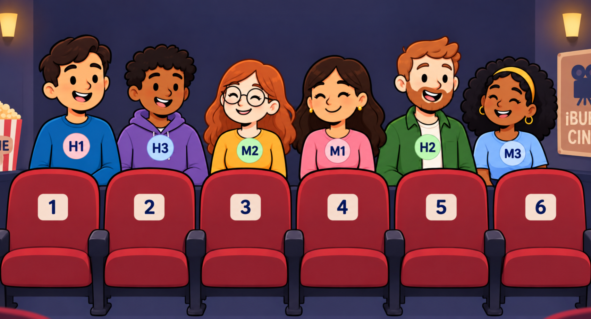
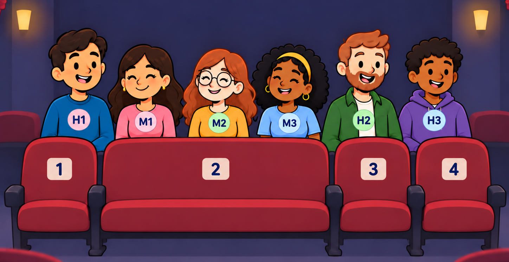

--- 
title: "Análisis combinatorio"
output: learnr::tutorial
runtime: shiny_prerendered
language: es
---


```{r setup, include=FALSE}

library(DiagrammeR)
library(gtools)
library(combinat)
library(learnr)

# Evitar que learnr guarde las respuestas y ejercicios
# entre una ejecución y otra del tutorial

options(
  tutorial.storage = list(

    save_object = function(tutorial_id,
                           tutorial_version,
                           user_id,
                           object_id,
                           data) {
      NULL
    },

    get_object = function(tutorial_id,
                          tutorial_version,
                          user_id,
                          object_id) {
      NULL
    },

    get_objects = function(tutorial_id,
                           tutorial_version,
                           user_id) {
      list()
    },

    remove_all_objects = function(tutorial_id,
                                  tutorial_version,
                                  user_id) {
      NULL
    }
  )
)

```


## Introducción (sección 1/ 10 min)

Este tutorial interactivo te permitirá explorar, de manera progresiva, algunas de las principales técnicas de conteo. A lo largo del material, resolverás situaciones problema con el apoyo de ejemplos, ejercicios y códigos en R que te ayudarán a identificar resultados posibles, construir espacios muestrales y verificar las posibilidades.

Los temas que trabajarás son los siguientes:


<ul>
  <li>Primeros pasos en R</li>
  <li>Conceptos previos sobre conteo </li>
  <li>Técnicas de conteo:
    <ol type="I">
      <li> El conteo de las posibilidades consecutivas (Principio fundamental del conteo)</li>
      <li> ¿Qué pasa cuando hay elementos que se repiten? (Permutaciones con elementos repetidos) </li>
      <li> En el conteo existen condiciones (Permutaciones con restricciones)</li>
      <li> Formas de elegir (Permutaciones y combinaciones)</li>
    </ol>
  </li>
</ul>

**Derecho básico de aprendizaje:** Resuelve problemas utilizando principios básicos de conteo.

**Estándar curricular:** Resuelvo y planteo problemas usando conceptos básicos de conteo y probabilidad (combinaciones, permutaciones, espacio muestral, muestreo aleatorio, muestreo con remplazo).

**Aprendizajes esperados**

Al finalizar el tutorial, se espera que seas capaz de:

*	Aplicar la técnica de conteo más adecuada para resolver diferentes situaciones problema.
*	Usar y modificar códigos en R para representar, calcular y verificar los resultados obtenidos en problemas de conteo.


## Primeros pasos en R (sección 1/ 95 min)

### ¿Qué es R?
R es un lenguaje de programación basado en texto y un entorno para el análisis estadístico y la visualización de datos. 

### Operaciones básicas

En R puedes realizar operaciones básicas como sumar, restar, multiplicar, dividir, calcular potencias o combinarlas.

Escribe una o varias operaciones y pulsa «Run Code» para ver los resultados. Puedes cambiar los números y probar nuevamente.


```{r practicar-aritmetica, exercise=TRUE}
# Escribe las operaciones que quieras probar.

# Suma + 

# Resta - 

# Multiplicación * 

# División / 

# Potencia ^ 

# Raíz cuadrada sqrt( )

# Operaciones combinadas con paréntesis 


```
 
 
### Asignación de variables
En R, se puede guardar valores en variables usando el operador = o  <-. Por ejemplo:
 
```{r variables-asignacion, exercise=TRUE}
# Guardamos el valor 5 en y
y <- 5

# Consultamos su valor
y
```

Podemos utilizar esa variable en otras operaciones y guardar los resultados en nuevas variables. Multiplicar `y` por 2 no cambia su valor; para guardar el resultado, lo asignamos a otra variable, digamos: `x`.

```{r variables-operaciones, exercise=TRUE}
y <- 5

# Multiplicamos y por 2
y * 2

# Consultamos y: sigue valiendo 5
y

# Guardamos el resultado en x
x <- y * 2

# Consultamos el valor de x
x
```

### Pongamos en práctica

Divide `x` entre `y` y guarda el resultado en una variable llamada `z`. Luego, escribe `z` en una nueva línea para consultar su valor.

```{r variables-practica, exercise=TRUE}
y <- 5
x <- y * 2

# Escribe aquí tu código

```

### Tipos de datos

R tiene varios tipos de datos, entre ellos:

- Numéricos: como 1, 3.14.
- Cadenas de texto: como "Hola Mundo".
- Vectores: una colección de elementos del mismo tipo.


### Crear un vector
Los vectores son estructuras unidimensionales que pueden contener elementos del mismo tipo (como números, cadenas de texto, etc.). En R, se puede crear un vector de varias formas, dependiendo de qué tipo de datos se desea almacenar.

Para crear un vector numérico, se puede usar la función c(), que concatena los valores dentro del vector. Ej:

v =c(1, 2, 3, 4, 5)  

también, se puede crear un vector de cadenas de texto de manera similar:

v=c("Juan", "Ana", "Pedro", "Maria")

### Pongamos en práctica

Imagina que estás organizando una tarde de juegos con tus amigos.

1. Crea un vector llamado `amigos` con sus nombres.

2. Crea otro vector llamado `dinero` con lo que trajo cada uno para pedir comida a domicilio.

Escribe el nombre de cada vector en una línea diferente y ejecuta el código para ver su contenido.


```{r practica-vectores, exercise=TRUE}
# Crea el vector amigos


# Crea el vector dinero


# Muestra el contenido de ambos vectores

```

### Funciones
En R, podemos invocar funciones existentes como `sum()` que suma los valores de un vector y `mean()` que calcula su promedio. 

Ejecuta el código y luego cambia los valores para observar los resultados.

```{r explorar-funciones, exercise=TRUE}

puntajes <- c(12, 8, 15, 10)

# Calcula la suma de los puntajes
sum(puntajes)

# Calcula el promedio de los puntajes
mean(puntajes)
```

Hay muchas funciones en R, y cada vez que quieras hacer algo, debes comenzar por buscar si ya existe alguna función para ésto. Si sabes qué quieres hacer, pero desconoces el nombre de la función, puedes buscar por palabras clave con ?? o help.search().

Por ejemplo, para buscar funciones relacionadas con el promedio: 
**??mean**

También puedes escribir:
**help.search("mean")**

Conviene utilizar palabras en inglés, como "mean" para promedio o "permutation" para permutaciones.


### Help - Ayuda

Cada que tengas una pregunta sobre una función de R, puedes conocer cómo funciona escribiendo `?` seguido de su nombre en la consola de RStudio. Por ejemplo, `?mean` permite consultar qué hace esa función y cómo utilizarla.

Ejecuta el código. Luego, cambia `mean` por `sum` o `sqrt` para explorar la ayuda de otras funciones.

```{r practicar-ayuda, exercise=TRUE}
# Consulta la ayuda de una función
?mean
```


## Algunos conceptos previos (sección 1/ 15 min)

```{r mapa-experimentos, echo=FALSE}
library(DiagrammeR)

grViz("
digraph mapa {

  graph [
    layout = dot,
    rankdir = TB,
    bgcolor = transparent,
    nodesep = 0.9,
    ranksep = 0.7
  ]

  node [
    shape = box,
    style = 'rounded,filled',
    fillcolor = white,
    color = black,
    fontname = Helvetica,
    fontsize = 14,
    margin = 0.18
  ]

  edge [
    color = black,
    penwidth = 1.5
  ]

  A [
    label = <<B>Experimento</B>>,
    fontsize = 18,
    width = 3
  ]

  B [
    label = <
      Es cualquier acción o<BR/>
      proceso que, al realizarse,<BR/>
     genera una o varias<BR/>
     observaciones.
    >,
    width = 3
  ]

  C [
    label = <
      Un <B>experimento<BR/>
      determinístico </B>  es  <BR/>
      cualquier experimento<BR/>
      que, al repetirse conservando las<BR/>
      mismas condiciones,<BR/>
      genera siempre los mismos<BR/>
      resultados.
    >,
    width = 3.8
  ]

  D [
    label = <
      Un <B>experimento aleatorio<BR/>
      o estocástico </B>  es cualquier<BR/>
      experimento que, al<BR/>
      repetirse bajo las mismas<BR/>
      condiciones, no genera<BR/>
      siempre los mismos<BR/>
      resultados
    >,
    width = 3.8
  ]

  A -> B
  B -> C
  B -> D

  {rank = same; C; D}
}
")
```


```{r cierre-experimentos, echo=FALSE}
learnr::question(
  "
  ¿cuál es la principal diferencia entre un experimento determinístico y uno aleatorio?",

  learnr::answer(
    "En un experimento aleatorio, el resultado puede predecirse siempre si repetimos exactamente las mismas condiciones."
  ),

  learnr::answer(
    "En un experimento determinístico, el resultado puede predecirse; en uno aleatorio, no puede conocerse con certeza.",
    correct = TRUE
  ),

  learnr::answer(
    "En un experimento determinístico, existen siempre más resultados posibles que en cualquier experimento de tipo aleatorio."
  ),

  allow_retry = TRUE,
  random_answer_order = TRUE
)

```

### Espacio muestral ($\Omega$)

Es el conjunto de todos los posibles resultados que resultan de realizar un experimento aleatorio. 


### Técnicas de conteo

Son los distintos métodos que utilizamos para encontrar el número de elementos que hay en $\Omega$. Una forma intuitiva es hacer una lista, es decir, identificar, enlistar y contar  todos los elementos que conforman el espacio muestral. 

Sin embargo, esta estrategia es adecuada principalmente cuando el número de resultados posibles es pequeño. Si tuviéramos que enumerar veinte, cincuenta o incluso más posibilidades, el proceso sería tedioso. Además, aumentaría el riesgo de omitir algún resultado o repetir una posibilidad sin darnos cuenta.

A continuación, explorarás cómo contar las posibilidades sin tener que enlistarlas.


## I. El conteo de las posibilidades consecutivas (tratamiento 1/ sección 2/ 60 min)


Cuando se realizan dos o más experimentos de manera consecutiva y queremos determinar el número total de resultados posibles al combinar las posibilidades de cada uno, utilizamos el **principio fundamental del conteo**, también conocido como **regla del producto**.

Cuando se realizan varios experimentos consecutivos, el número total de resultados posibles se obtiene multiplicando la cantidad de posibilidades de cada experimento.


1\. **Ejemplo:** Con las letras de la palabra PALO. ¿Cuántas palabras con o sin sentido se pueden formar?

Para hacerlo en R, primero creamos un vector llamado **elementos** con las letras que queremos ordenar. Prueba modificando las letras a ordenar y/o el nombre  del vector (**elementos**)y ejecuta el código para observar el resultado.

```{r dados-permutacionessss, exercise=TRUE}
# Definimos los posibles resultados de un dado
elementos <- c("P","A","L","O")

elementos
```


Luego, utilizamos la función **permutations()** para generar todas las formas posibles de organizarlos. Dentro de la cual:

- **n** indica cuántos elementos diferentes tenemos disponibles.
- **r** indica cuántos elementos se utilizarán en cada arreglo.
- **v** señala cuál es el vector que contiene los elementos. 
- **repeats.allowed = FALSE** cuando no queremos que un mismo elemento se repita en cada escogencia. En caso contrario, escribimos **TRUE**.

```{r dados-permutaciones, exercise=TRUE}
# Definimos los posibles resultados de un dado
elementos <- c("P","A","L","O")

# Generamos todos los resultados posibles de los dos dados
resultados <- permutations(
  n = 4,
  r = 4,
  v = elementos,
  repeats.allowed = FALSE
)

# Número total de resultados
nrow(resultados)

# Mostramos todos los resultados posibles
resultados
```

Para usar este código en otras situaciones problema, no es necesario modificarlo por completo. Solo debes cambiar los valores que aparecen dentro del vector elementos y ajustar n, r, TRUE O FALSE, según corresponda. Si los elementos son categóricos, como palabras, letras o símbolos, debes escribir cada uno entre comillas y separarlos por comas. Si son números, no es necesario hacer eso.

### Pongamos en práctica

2\. **Ejemplo:** A Pedro le acaban de comprar los 5 libros que le pidieron en su lista de útiles. Digamos, matemáticas, física, biologia, español y arte. Él quiere organizarlos en el espacio disponible en su biblioteca. Cuenta y muestra el número de maneras diferentes en que se pueden organizar los libros. 

3\. **Ejemplo:** Una moneda de 100 pesos y otra de 200 pesos, se lanzan al suelo. ¿De cuántas maneras pueden caer?

4\. **Ejemplo:** Un examen consta de ocho preguntas de falso y verdadero. ¿De cuántas maneras diferentes puede contestarse el examen completo?

5\. **Ejemplo:** Un examen tiene 5 preguntas con cuatro opciones de respuesta. ¿De cuántas maneras puede responderse?


## II. ¿Qué pasa cuando hay elementos que se repiten? (tratamiento 1/ sección 3/ 60 min)

Hasta ahora hemos trabajado con situaciones en las que todos los elementos son diferentes. Por ejemplo, si tenemos las letras:

$$ A,\ B,\ C $$
Las posibles ordenaciones son:

$$
ABC,\ ACB,\ BAC,\ BCA,\ CAB,\ CBA
$$
En este caso, cambiar de posición dos letras siempre produce una ordenación diferente. Sin embargo, la situación cambia cuando algunos elementos son iguales entre sí. Por ejemplo, si tenemos:

$$ A,\ A,\ B $$

Las posibles ordenaciones son:

$$ AAB,\ ABA,\ BAA $$
Es evidente que si intercambiamos de posición las dos letras \(A\), como ambas son iguales, el resultado no cambia. Es decir, cuando hay elementos repetidos, solo contamos las formas que producen una organización realmente distinta. Por lo tanto, cuando algunos elementos se repiten, el número de arreglos diferentes es menor que el que obtendríamos si todos los elementos fueran distintos.


1\. **Ejemplo:** Utiliza la inicial de tu primer nombre y las iniciales de tus dos apellidos para construir una clave de seis letras, repitiendo cada inicial exactamente dos veces. ¿Cuántas claves diferentes puedes formar?

Para hacerlo en R, creamos un vector que hemos llamado elementos, en él escribimos todos los elementos que queremos ordenar, incluyendo aquellos que se repiten. 


```{r preparar-permutaciones-repetidas, include=FALSE}
library(combinat)

resolver_permutaciones <- function(elementos) {

  # Cantidad total de elementos
  n <- length(elementos)

  # Cantidad de veces que aparece cada elemento
  repeticiones <- table(elementos)

  # Número de permutaciones diferentes
  total <- factorial(n) / prod(factorial(repeticiones))

  # Generamos las permutaciones
  permutaciones <- unique(permn(elementos))

  # Organizamos los resultados
  resultados <- do.call(rbind, permutaciones)

  # Mostramos los resultados
  cat("Número de permutaciones diferentes:", total, "\n\n")
  print(resultados)
}
```

```{r permutaciones-repetidas-2, exercise=TRUE, exercise.setup="preparar-permutaciones-repetidas"}

# modifica este vector con las iniciales de tu nombre

elementos <- c("E","E","J","J","D","D")

resolver_permutaciones(elementos)
```

Para usar este código en otras situaciones problema, solo debes cambiar los valores que aparecen dentro del vector elementos. R se encargará automáticamente de identificar cuántos elementos hay, cuáles se repiten y mostrarte cuántas ordenaciones diferentes pueden formarse.

### Pongamos en práctica

2\. **Ejemplo:** Se ordenan en una fila 5 bolas rojas, 2 bolas blancas y 3 bolas azules. Si las bolas de igual color no se distinguen entre sí. ¿De cuántas formas posibles pueden ordenarse?

3\. **Ejemplo:** Una estudiante forma una secuencia con las letras de la palabra “BANANA”.
¿Cuántos arreglos diferentes puede formar?


4\. **Ejemplo:** En una biblioteca se exhiben 11 libros: 5 de matemáticas iguales, 4 de física iguales y 2 de química iguales.¿De cuántas maneras pueden acomodarse?

5\. **Ejemplo:** Con las letras de la palabra “MISSISSIPPI” se forman arreglos.¿Cuántos diferentes pueden hacerse?


## III. En el conteo existen condiciones (tratamiento 2/ sección 2/ 60 min)

En los apartados anteriores hemos contado formas de ordenar elementos suponiendo que todos pueden ubicarse libremente. Sin embargo, en algunas situaciones aparecen condiciones que limitan las posibles ordenaciones.

Por ejemplo, puede ocurrir que ciertos elementos tengan que permanecer agrupados o que un elemento deba ocupar una posición específica. En estos casos no todas las ordenaciones posibles son válidas. Por eso, antes de contar, debemos identificar la condición que impone el problema y organizar los elementos de manera que esa condición se cumpla.

Consideremos la siguiente situación: tres parejas de casados han comprado seis boletas para el cine y se sentarán en una fila de seis asientos, tal como se muestra en la imagen.

<div style="text-align: center;">
  
</div>

Como no existe ninguna condición sobre la manera en que deben sentarse, las seis personas pueden organizarse libremente en los seis asientos. Por lo tanto, el número de formas posibles de ubicarlas corresponde a:

$$
6 \times 5 \times 4 \times 3 \times 2 \times 1 = 720
$$

1\.  **Ejemplo:** Ahora supongamos que queremos contar de cuántas formas diferentes pueden ubicarse si las tres mujeres han decidido sentarse juntas. 

En este caso, podemos considerar a las tres mujeres como un solo bloque, ya que deben permanecer consecutivas. De esta manera, ordenamos cuatro unidades: el bloque formado por las tres mujeres y los tres hombres. Visualmente, la situación puede representarse así:

<div style="text-align: center;">
  
</div>


Para hacerlo en R, usamos el siguiente código el cual debes modificar en dos partes:

1- En **unidades <-** escribe cuántas unidades quedan por ordenar después de considerar cada grupo que debe permanecer junto como una sola unidad. 

2- En **grupos <- c()** indica cuántos elementos contiene cada bloque. 


```{r preparar-restricciones, include=FALSE}
resolver_restricciones <- function(unidades, grupos) {

  # Formas de ordenar las unidades
  orden_externo <- factorial(unidades)

  # Formas de ordenar los elementos dentro de los grupos
  orden_interno <- prod(factorial(grupos))

  # Número total
  total <- orden_externo * orden_interno

  # Mostrar resultado
  cat("Número total de arreglos:", total)
}
```

```{r restricciones-bloques, exercise=TRUE, exercise.setup="preparar-restricciones"}
unidades <- 5
grupos <- c(2)

resolver_restricciones(unidades, grupos)
```

Si en otro problema hay más de un grupo que debe permanecer junto, puedes indicar el tamaño de cada grupo dentro del vector; por ejemplo, grupos <- c(2, 3) representa un grupo de dos elementos y otro de tres.

Si la condición indica que un elemento debe ocupar una posición determinada, fijamos primero esa posición y luego contamos las formas de ordenar los elementos restantes en los lugares disponibles.

### Pongamos en práctica

2\. **Ejemplo:** Tres parejas de casados han comprado seis boletas para el cine y se sentarán en una fila de seis asientos. ¿De cuántas formas diferentes pueden ubicarse si las tres mujeres han decidido sentarse juntas y los tres hombres también?

3\. **Ejemplo:**  Tres parejas de casados han comprado seis boletas para el cine y se sentarán en una fila de seis asientos. ¿De cuántas formas diferentes pueden ubicarse si cada persona desea sentarse junto a su pareja?

4\.  **Ejemplo:** Se tienen seis libros diferentes: dos de matemáticas, dos de física y dos de química. ¿De cuántas formas pueden colocarse en un estante si los libros de cada asignatura deben quedar juntos?

5\. **Ejemplo:** Seis atletas se ubican en fila para una fotografía. ¿De cuántas formas pueden organizarse si el capitán debe ocupar uno de los extremos?


## IV.Formas de elegir (tratamiento 2/ sección 3/ 60 min)

Para finalizar este tutorial interactivo, trabajaremos con situaciones en las que, al contar, no solo nos interesa saber cuántas formas existen de elegir algunos elementos de un grupo, sino también determinar si el orden de esa elección cambia o no el resultado. 

Imaginemos la situación en la cual de cinco personas, digamos:

$$
\\Ana,\  Bruno,\ Camila,\  Daniel\  y\  Elena.\ 
$$


Queremos seleccionar a dos de ellos que juntos realicen una tarea. Pero, antes de pensar en algún cálculo, analiza la siguiente pregunta:


```{r pregunta-combinacion-1, echo=FALSE}
question(
  "Si seleccionamos a Ana y Bruno, ¿obtenemos un grupo diferente si mencionamos primero a Bruno y luego a Ana?",
  
  answer("Sí, porque cambió el orden."),
  
  answer(
    "No, porque siguen siendo los mismos dos.",
    correct = TRUE
  ),
  
  allow_retry = TRUE,
  random_answer_order = TRUE
)
```


En este caso, seleccionar a Ana y Bruno es lo mismo que seleccionar a Bruno y Ana:

$$
\text{Ana, Bruno} = \text{Bruno, Ana}
$$

Esto ocurre porque únicamente nos interesa saber quienes fueron seleccionados, y no el orden en que fueron elegidos. En este tipo de situaciones, las personas o elementos seleccionados no ocupan cargos, funciones particulares o posiciones diferentes, entonces hablamos de una **combinación**.

```{r pregunta-pizza, echo=FALSE}
learnr::question(
  "¿Cuál de las siguientes situaciones corresponde a una combinación?",

  learnr::answer(
    "Elegir 3 ingredientes entre 10 disponibles para ordenar una pizza.",
    correct = TRUE
  ),

  learnr::answer(
    "Asignar las medallas de oro, plata y bronce."
  ),

  learnr::answer(
    "Elegir presidente, vicepresidente y secretario."
  ),

  learnr::answer(
    "Crear una clave de 4 dígitos."
  ),

  allow_retry = TRUE,
  random_answer_order = TRUE
)
```

Una forma sencilla de reconocer una combinación es preguntarnos: Si cambio el orden de un par de elementos seleccionados, ¿obtengo un resultado diferente? Si la respuesta es no, estamos ante una combinación.

```{r pregunta-aaaa, echo=FALSE}
learnr::question(
  "Una aplicación permite seleccionar 4 fotografías de una colección de 15 para crear un álbum. ¿En cuál de las siguientes situaciones usaríamos una combinación?",

  learnr::answer(
    "Cuando solo interesa cuáles 4 fotografías fueron seleccionadas.",
    correct = TRUE
  ),

  learnr::answer(
    "Cuando cada fotografía debe ocupar una posición específica del 1 al 4."
  ),

  learnr::answer(
    "Cuando se debe escoger una fotografía para portada, dos para el centro y una para el final."
  ),

  allow_retry = TRUE,
  random_answer_order = TRUE
)
```

1\. **Ejemplo:** Una biblioteca escolar dispone de 10 novelas y una estudiante debe escoger 4 para llevar durante las vacaciones. ¿Cuántas selecciones diferentes puede realizar?


```{r pregunta-antes-calcular, echo=FALSE}
learnr::question(
  "Antes de realizar el cálculo: ¿por qué podemos utilizar una combinación en este problema?",

  learnr::answer(
    "Porque queremos ordenar las 10 novelas disponibles."
  ),

  learnr::answer(
    "Porque importa el orden en que se seleccionan las 4 novelas."
  ),

  learnr::answer(
    "Porque cada una de las 4 novelas ocupará una posición diferente."
  ),

  learnr::answer(
    "Porque solamente importa cuáles 4 novelas se seleccionan, no el orden en que se eligen.",
    correct = TRUE
  ),

  allow_retry = TRUE,
  random_answer_order = TRUE
)
```


Para hacerlo en R, usamos dos valores que debes identificar y modificar en cada situación problema. 

- **n** escribe el número total de elementos disponibles.  
- **r** indica cuántos de esos elementos quieres seleccionar. 
- La función **choose(n, r)** calcula cuántas combinaciones diferentes pueden formarse

```{r ejercicio-combinacion-1-v2, exercise=TRUE}

n <- 
r <- 

choose(n, r)
```


### Pongamos en práctica

2\. **Ejemplo:** Una biblioteca escolar dispone de 10 novelas y una estudiante debe escoger 4 para llevar durante las vacaciones. ¿Cuántas selecciones diferentes puede realizar?

3\. **Ejemplo:** Un docente propone 14 problemas y cada estudiante debe resolver exactamente 7. ¿Cuántos grupos de problemas pueden seleccionarse?


4\. **Ejemplo:** Una prueba contiene 15 preguntas y el estudiante debe contestar solo 10. El orden no se tiene en cuenta. ¿Cuántas selecciones son posibles?


5\. **Ejemplo:** En una heladería, un cliente puede elegir 3 toppings distintos entre 10 disponibles para agregar a su helado. ¿De cuántas formas distintas puede hacer su selección?


